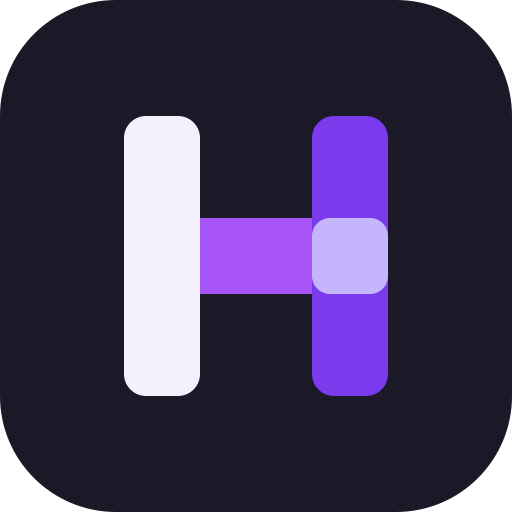

# Han1meBox

<p align="center">
  
</p>

<p align="center">
  <b>跨平台非官方第三方桌面客户端（Linux / Windows）</b><br>
  Linux AppImage · Windows 安装版 / 免安装版 · 本地数据备份<br>
  <sub>基于 Electron + React + TypeScript 构建 · 源自 Han1mePlus</sub>
</p>

<p align="center">
  
  
  
</p>

<p align="center">
  <a href="../../releases/latest">下载最新版</a> · <a href="../../releases">全部版本</a>
</p>

## 简介

**Han1meBox** 是一款面向 **Linux 与 Windows** 的开源桌面客户端，基于 [Han1mePlus](https://github.com/1wc10086/Han1mePlus) 的设计与功能，采用 Electron + React + TypeScript + Material Design 重新实现，提供更好的桌面端兼容性与跨平台体验。

> 本项目为个人维护的非官方第三方开源客户端，与目标站点无任何关联。

## 功能特性

- **跨平台桌面端**：原生支持 Linux（AppImage）与 Windows（标准安装包 + 绿色免安装版）
- **浏览与发现**：首页分区、新番预告、多条件搜索与标签筛选、影片详情、评论与相关推荐
- **视频与漫画**：内置 HLS / 原生视频播放，支持漫画分页与缩放阅读
- **账号与片单**：支持站点账号登录与手动 Cookie 导入，同步观看历史、收藏、稍后观看、播放清单、订阅与通知
- **本地备份**：支持配置、记录与片单的本地导入导出，方便跨设备迁移
- **界面体验**：Material Design 风格，支持浅色 / 深色主题与多页面状态保持

## 下载与安装

前往本仓库的 [Releases](../../releases/latest) 页面下载对应平台的最新版本。

### Windows

- **推荐：安装版** —— `Han1meBox Setup *.exe`
  - 标准安装向导，支持自定义安装目录，自动创建快捷方式并可正常卸载。
- **免安装版** —— `Han1meBox-*-win.zip`
  - 解压后直接双击运行。

### Linux

- **AppImage** —— `Han1meBox-*.AppImage`
  - 下载后赋予可执行权限即可直接运行：

```bash
chmod +x Han1meBox-*.AppImage
./Han1meBox-*.AppImage
```


## 常见问题

<details>
<summary>Windows 首次运行提示「未知发布者」或被安全软件拦截？</summary>

安装包目前没有购买商业代码签名证书，属于未签名开源软件的正常提示。点「更多信息」→「仍要运行」即可，也可以选择下载免安装版（`.zip`）解压运行。

</details>

<details>
<summary>Linux 下 AppImage 无法启动？</summary>

请先确认已赋予可执行权限（`chmod +x`）。如果系统未安装 `libfuse2`，可以尝试使用 `./Han1meBox-*.AppImage --appimage-extract-and-run` 运行，或安装系统对应的 FUSE 运行库。

</details>

<details>
<summary>无法在应用内直接使用 Google 账号登录？</summary>

Google 安全策略会拦截第三方内嵌浏览器的 OAuth 登录。若账号仅绑定了 Google，请先在常规浏览器中完成登录，再通过应用内的「导入 Cookie」功能同步登录状态。

</details>

<details>
<summary>更新或覆盖安装会丢失本地数据吗？</summary>

不会。所有配置、账号状态、观看记录与片单均保存在系统用户数据目录，覆盖安装或替换 AppImage / 绿色版文件均不影响已有数据：

- **Linux**：`~/.config/han1me-box/`
- **Windows**：`%APPDATA%\han1me-box\`

</details>

## 鸣谢

- [Han1mePlus](https://github.com/1wc10086/Han1mePlus)：本项目的设计与功能来源，感谢原作者的开源贡献。


## 隐私、协议与免责声明

### 隐私政策

- 本程序完全在本地运行，**不包含任何遥测、统计或向第三方服务器上传数据的行为**。
- 除用户主动访问的目标站点外，应用不会向其他外部服务器发送个人数据。
- 所有配置、登录凭据（Cookie）、观看记录、片单与本地日志均仅存储于本机用户数据目录，不会自动上传。

### 开源协议

本项目遵循 [AGPL-3.0](./LICENSE) 协议开源。作为 [Han1mePlus](https://github.com/1wc10086/Han1mePlus)的衍生与重写项目；分发本软件及其二进制产物时须遵守 AGPL-3.0 条款。

### 免责声明

- 本项目为**非官方第三方客户端**，与任何内容站点无从属或合作关系。
- 本项目仅供年满 **18 周岁**（或所在地区法定成年年龄）的成年人使用。
- **合规自负**：使用者须自行确认并遵守所在地区的法律法规以及所访问平台的服务条款。
- **按“现状（As-Is）”提供**：开发者不保证本程序运行的连续性、稳定性、兼容性或账号安全，不对因使用本项目造成的任何直接或间接损失、账号异常或法律纠纷承担任何责任。
- 下载、安装、编译或运行本项目即视为您已阅读、理解并完全同意上述全部条款。
